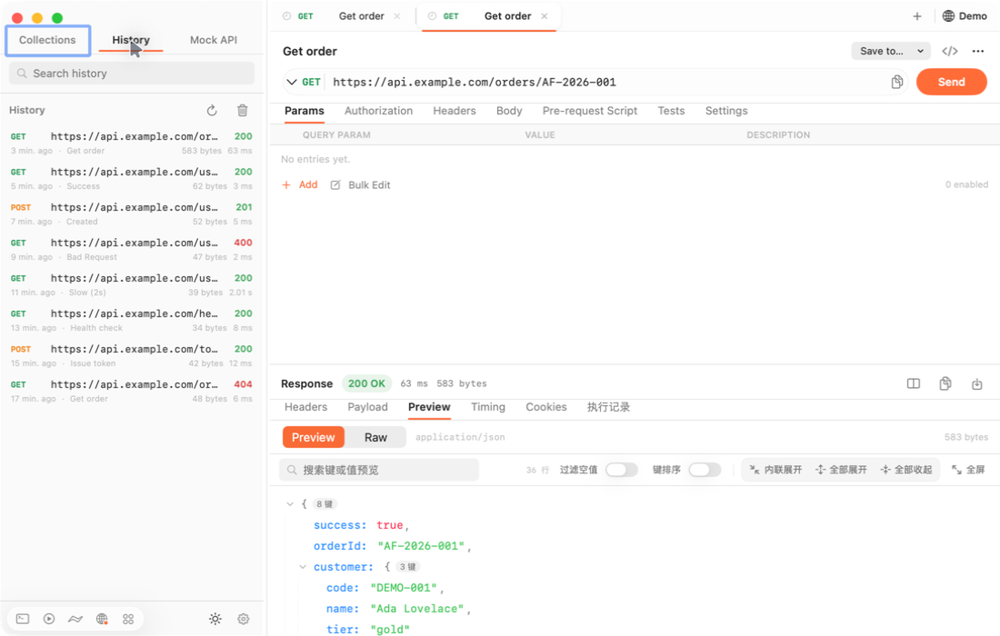
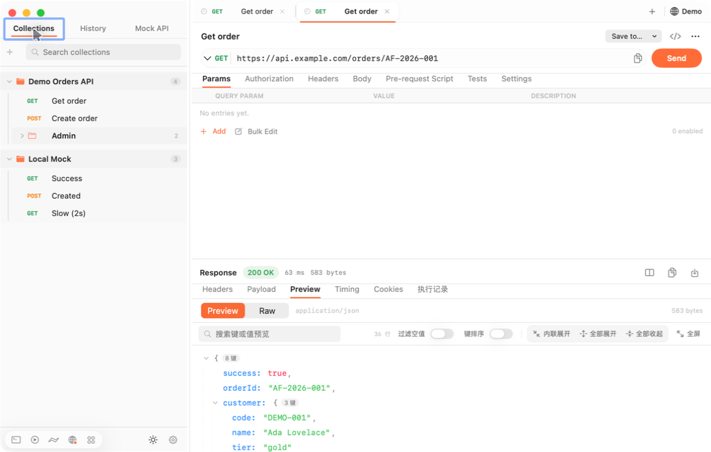
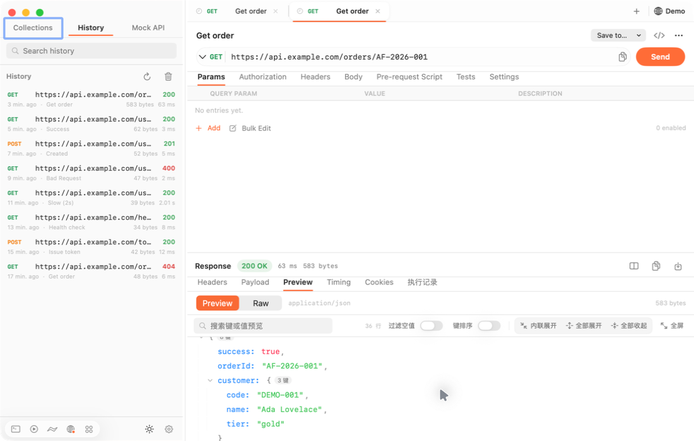
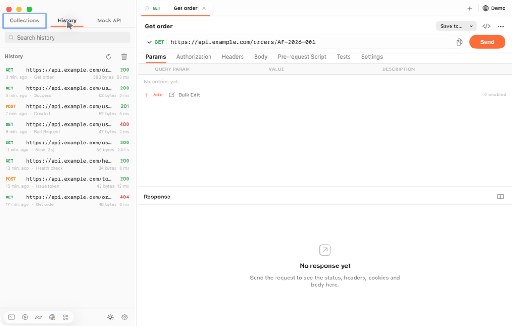
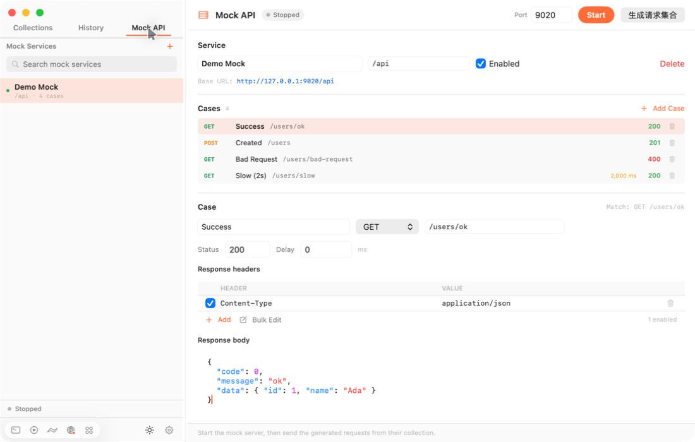
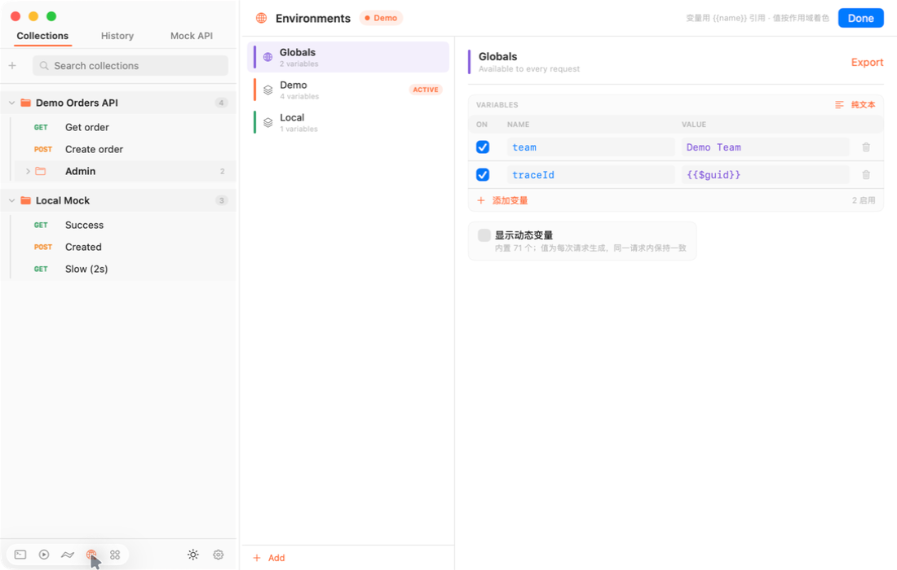
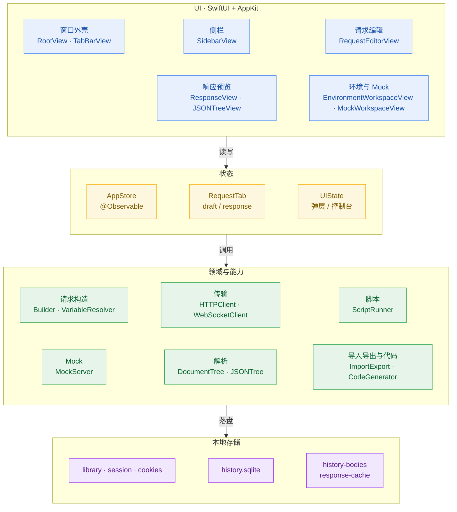
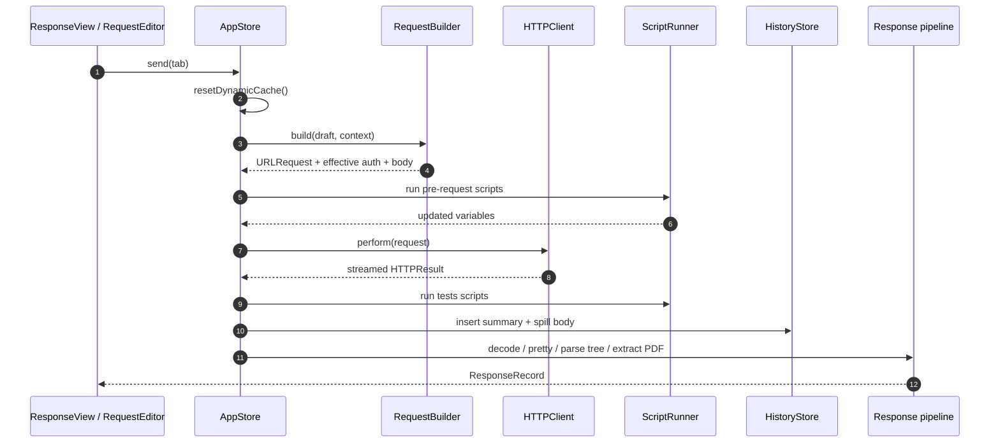
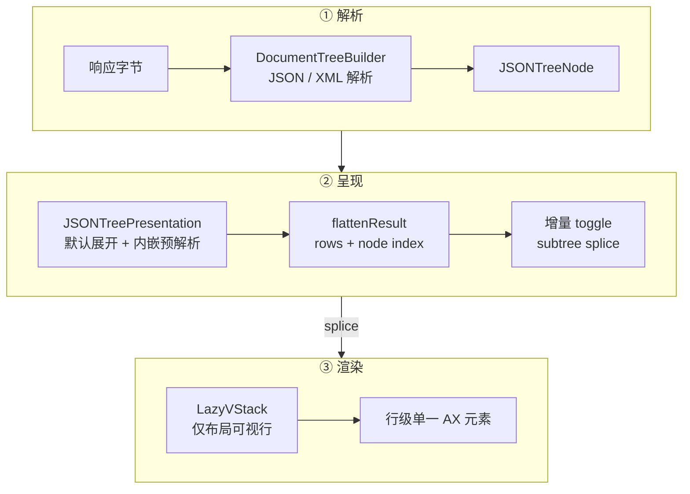

# postmanSwift

一个 **local-first** 的原生 macOS API 客户端：SwiftUI + AppKit 实现，不依赖账号、云同步与遥测。目标是覆盖日常 API 调试的核心路径——Collections、环境变量、脚本、Mock、Runner、WebSocket——同时把大响应、嵌套 JSON 的预览与滚动做流畅。



## 为什么用它

- **原生体验**：SwiftUI 界面 + AppKit 细节（窗口、字段编辑器、NSTextView），TextKit 2 渲染大文本，适配 Liquid Glass。
- **本地优先**：数据全部落在本机，没有登录、云同步、账号体系或使用统计。
- **大响应友好**：流式下载、响应体落盘、Raw 全文不截断、JSON 树分页与虚拟化，1.7MB 级响应可展开与滚动。
- **可脚本化**：Pre-request / Tests 直接在 JavaScriptCore 里执行 `pm.*`，支持变量、断言与 console。

## 功能

### 请求与集合

- Collections / 文件夹 / 请求三级结构，支持拖动排序、跨文件夹移动、复制、重命名、删除。
- 请求编辑器：Method、URL、Query Params、Headers（含预设）、Body（raw / form-data / urlencoded / GraphQL / binary file）。
- 认证：Basic、Bearer、API Key、OAuth 1.0 / 2.0、Digest、NTLM 等，支持集合/文件夹继承。
- 请求标签页：底部橙色指示条、清晰的标签分隔、右键批量关闭，历史请求以独立标签打开。
- 代码片段生成、cURL 复制、集合导入导出（Postman v2.0 / v2.1、OpenAPI / Swagger）。

### 变量与脚本

- Environment / Globals / Collection / Folder / Request 五级变量，优先级从内到外。
- `{{variable}}` 输入即补全，变量 hover 显示来源与当前值，未定义变量红色高亮。
- 69 个动态变量（`{{$timestamp}}`、`{{$guid}}`、`{{$randomInt}}` 等），同一请求内取值稳定；Globals 页可一键展示动态变量清单。
- 环境支持纯文本 `key: value` 编辑与着色、拖动排序、快速切换。
- Pre-request / Tests 脚本：`pm.environment`、`pm.collectionVariables`、`pm.test`、`pm.response` 等常用 API。

### 响应与预览

- 响应元信息：状态码、耗时、大小；Headers / Payload / Preview / Timing / Cookies / 执行记录分栏。
- JSON / XML 树：嵌套展开、内联 JSON 字符串展开、过滤空值、键排序、递归展开/收起、搜索、全屏。
- 内嵌 base64 PDF / 图片原位预览，PDF 独立查看器，原始字节可复制/下载。
- Raw 全文不截断；超大文本异步准备并落盘缓存，滚动只布局可视区域。
- 历史记录：SQLite 存摘要，正文按需加载；重复打开大响应不会让内存持续增长。

### 工具

- **Mock API**：服务 / case 管理、启动本地 Mock 服务、生成请求集合、case 与 service 拖动排序。
- **Collection Runner**：批量执行、迭代、结果汇总。
- **WebSocket**：连接、发送、消息时间线。
- **Cookies**：查看 / 删除 / 清理。
- **Console**：查看脚本日志与请求过程。

### 外观

- 浅色 / 深色 / 跟随系统；macOS 26 上使用 Liquid Glass，旧系统降级为系统材质。
- 上下 / 左右两种工作区布局，可拖动分栏。

## 截图

| 集合与请求 | JSON 预览 |
|---|---|
|  |  |
| Collections 树、请求编辑与响应预览 | 内联 JSON 展开、过滤/排序/展开工具栏 |

| 历史记录 | Mock API |
|---|---|
|  |  |
| 历史摘要与按需加载响应 | 服务 / case 编辑与本地 Mock 服务 |

| 环境变量 |
|---|
|  |
| 多环境、Globals、动态变量、纯文本模式 |

> 截图使用内置演示数据（`api.example.com`、虚构订单号），不包含任何真实业务信息。

## 架构

### 分层



### 请求生命周期



### JSON 预览管线



要点：

- 顺序即数组顺序：集合、文件夹、Mock 服务/case 的顺序直接使用数组顺序，无额外 order 字段。
- 大响应三层预算：响应体落盘 → 预览最多 4000 行 → 页面首屏 600 行，后续按页加载。
- 树操作增量更新：展开/收起只 splice 当前子树；只有排序、过滤或超出预算时才全量重建。

## 目录结构

```
postmanSwift/
├── Package.swift                 # SwiftPM：可执行目标 + 测试目标
├── Sources/PostmanSwift/
│   ├── App/                      # @main、窗口、版本信息
│   ├── Models/                   # Collection / Request / Mock / JSON 模型
│   ├── Store/                    # AppStore、RequestTab、HistoryStore
│   ├── Core/                     # HTTP、变量、脚本、Mock、导入导出、JSON 树
│   ├── Utilities/                # 主题、语法高亮、URL/窗口工具
│   └── Views/                    # SwiftUI 与 AppKit 桥接视图
├── Tests/PostmanSwiftTests/      # 单元测试与端到端测试
├── Scripts/                      # 应用打包、图标、性能基准
├── Assets/                       # 应用图标
├── docs/images/                  # README 截图
├── .agent/                       # 设计与性能档案（见下）
└── dist/                         # 本地构建产物（不进仓库）
```

## 快速开始

要求：macOS 14+，Xcode 16+（Swift 6 工具链）。

```bash
git clone https://github.com/lfvepclr/postmanSwift.git
cd postmanSwift

# 直接运行
swift run PostmanSwift

# 或打包成 .app
./Scripts/build_app.sh release
open dist/PostmanSwift.app
```

开发与测试：

```bash
swift build
swift test

# 独立数据目录（不碰日常数据）
POSTMANSWIFT_DATA_DIR=/tmp/postmanswift-dev swift run PostmanSwift
```

性能基准：

```bash
Scripts/perf-bench.sh launch                 # 构建隔离实例并打印 pid
Scripts/perf-bench.sh record <pid> 30 "Time Profiler"
Scripts/perf-bench.sh report <trace> baseline
Scripts/perf-bench.sh scenario               # 固定交互脚本
```

基准与计划归档在 [`.agent/perf-baseline/`](.agent/perf-baseline/README.md)、[`.agent/plans/`](.agent/plans/20261028-performance-optimization.md)。

## 使用

### 1. 发送请求

1. 左侧 `Collections` 新建集合/请求，或 `⌘N` 新建请求。
2. 输入 URL，选择方法，填写 Params / Headers / Body。
3. `⌘↩` 发送；响应区默认打开 `Preview`，可切换 Headers / Payload / Timing / Cookies / 执行记录。
4. 未保存的请求标签带橙色圆点；`⌘S` 保存到集合。

### 2. 变量与环境

- 左下角地球图标进入 Environments：可切换环境、编辑变量、开启“显示动态变量”。
- 任何支持变量的输入框输入 `{{` 会弹出补全；悬停变量可看到来源。
- 动态变量在同一请求内保持一致，例如 `{{$timestamp}}` 多次引用结果相同。

### 3. 脚本

- 请求级与集合/文件夹级 Pre-request、Tests 脚本会被继承并按顺序执行。
- 常用 `pm.*` API 可用，`console.log` 输出到 Console。

### 4. Mock

- `Mock API` 页新增服务与 case，设置 method / path / status / delay / headers / body。
- `Start` 启动本地服务（默认 9020），`生成请求集合` 会把 case 转成可直接发送的集合。

### 5. Runner 与 WebSocket

- 底部 Runner 图标批量执行集合，支持迭代与结果汇总。
- WebSocket 图标打开连接控制台，支持连接、发送与消息查看。

### 6. 导入 / 导出

- 侧栏加号菜单：Import（Postman / OpenAPI / Swagger）、Export Collection、Export Backup。
- 请求工具栏 `</>` 生成代码片段，支持复制为 cURL。

## 数据与隐私

- 数据目录：`~/Library/Application Support/PostmanSwift/`
  - `library.json`：集合、环境、Globals、Mock、设置
  - `history.sqlite` + `history-bodies/`：历史摘要与响应体
  - `session.json`、`cookies.json`、`response-cache/`
- 旧版本数据目录 `PostmanNative/` 会在首次启动时自动迁移。
- 无账号、无云同步、无遥测；所有请求从本机直接发出。

## 性能

2026-10-28 的 release 基线（隔离数据、1.7MB JSON、展开 + 滚动）：

| 指标 | 结果 |
|---|---|
| Time Profiler | 0 hangs，CPU 0.95s / 26s |
| SwiftUI hitches | 32 次 / 0.5s，最差 192ms（优化前 803 次 / 11.6s，最差 254ms） |
| AX 轮询 | 0 hangs（优化前单次快照可造成 665ms 停顿） |
| 1.7MB 响应连续打开 5 次 | RSS 170MB → 174MB |
| flatten / presentation | 0.027ms / 0.087ms（574B 样本） |

细节、trace 与复现脚本见 [`.agent/perf-baseline/`](.agent/perf-baseline/README.md)。

## 已知限制

- 仅支持 macOS 14+；构建产物未做公证（notarization），首次打开需在“隐私与安全性”中允许。
- 暂不支持多窗口、团队协作、云端同步。
- 解析层级与单次渲染行数有上限（JSON 4000 行 / 首屏 600 行），极端嵌套会提示截断。
- 当前 Xcode 26.6 下 SwiftUI 模板不产出视图级更新泳道，性能归档只包含 hitch 总数与主线程调用栈。

## 仓库说明

- `.agent/` 保存性能与架构档案：`plans/`、`architecture/`、`perf-baseline/`（trace 已压缩，共约 29MB）。
- 不纳入仓库：`.build/`、`dist/`、`.swiftpm/`、`test_case/`（本地大响应样例）以及基准 trace 临时解压目录。
